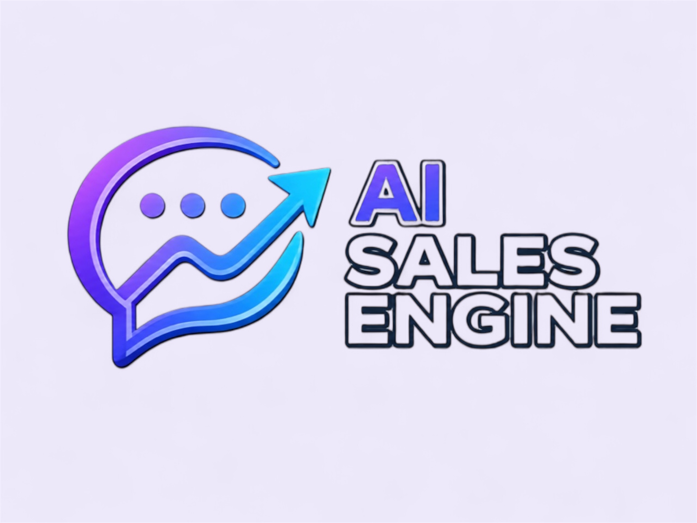
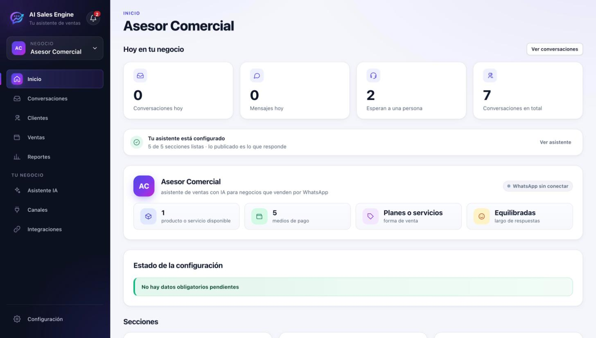
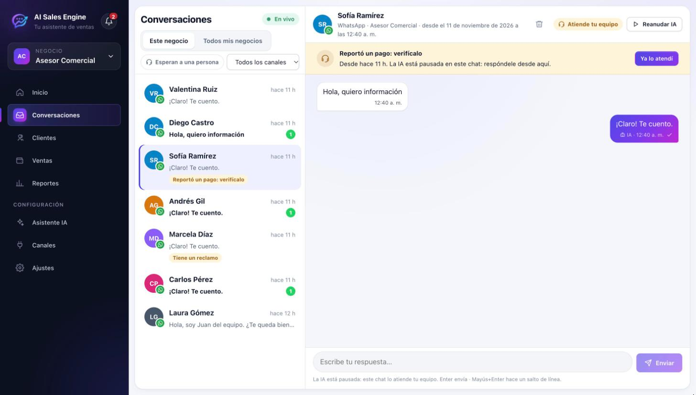
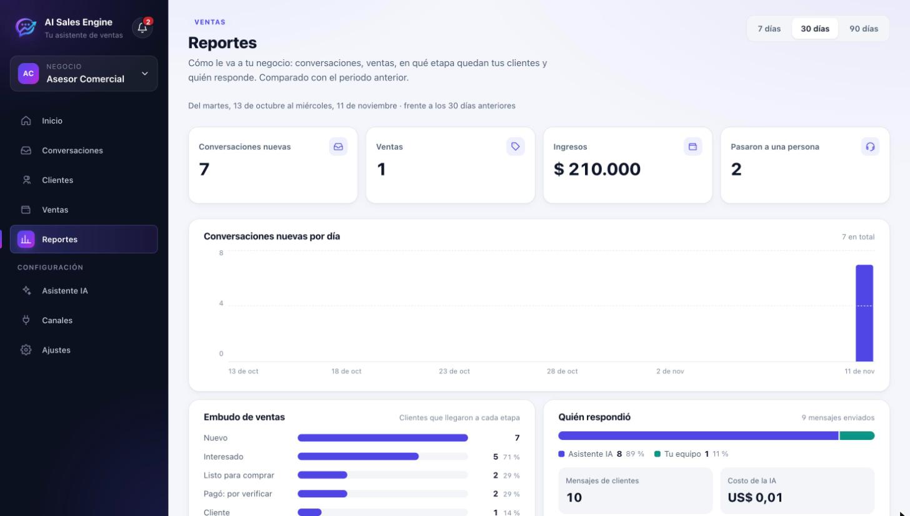
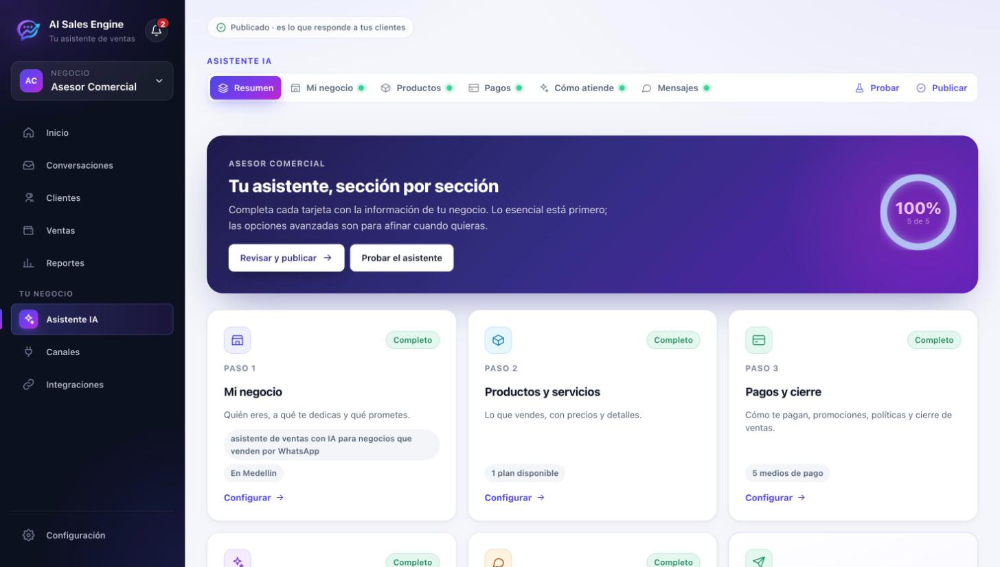
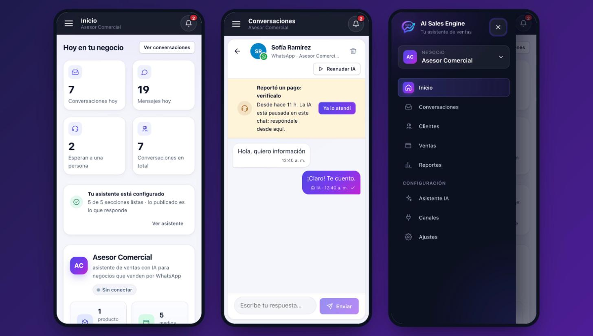
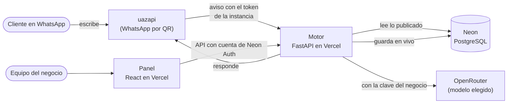

<p align="center">
  
</p>

<h1 align="center">AI Sales Engine</h1>

<p align="center">
  <strong>Un asistente de ventas con IA para WhatsApp, como servicio.</strong><br/>
  Cada negocio crea su cuenta, enseña a su asistente lo que vende, conecta su WhatsApp y atiende desde un solo panel.
</p>

<p align="center">
  <a href="https://github.com/JuanCrzP1/Ai-sales-engine/actions/workflows/ci.yml"></a>
  
  
  
  
  
  <a href="LICENSE"></a>
</p>

<p align="center">
  
</p>

---

## Qué hace

La mayoría de los negocios no pierde ventas por falta de clientes: las pierde porque nadie responde a tiempo, o se responde sin
contexto y la conversación no avanza. AI Sales Engine atiende cada chat al instante, con la información real del negocio, y lo
lleva hacia la compra; cuando hace falta una persona, se la pasa al equipo y le avisa.

| Para el negocio | Cómo funciona |
|---|---|
| **Un asistente que vende** | Responde con lo que el negocio publicó: productos, precios, pagos, políticas y su forma de vender. No inventa precios ni planes. |
| **WhatsApp en un minuto** | El negocio toca «Conectar WhatsApp» y escanea un código QR. El servidor y los tokens los pone la plataforma. |
| **Conversaciones en vivo** | Como WhatsApp Web: escribiendo…, chulos de enviado y leído, no leídos, fotos y notas de voz que la IA entiende. |
| **Paso a una persona** | Si el cliente pide hablar con alguien, reclama o reporta un pago, el chat pasa al equipo según su horario. El equipo recibe aviso en la campana, por correo y en el celular, y si nadie responde a tiempo la IA retoma el chat. |
| **Clientes y ventas** | Cada cliente con su etapa (nuevo, interesado, listo, pagó, cliente), que avanza sola. Las ventas se registran desde el chat. |
| **Reportes** | Embudo, conversaciones por día, quién respondió y cuánto costó la IA, comparados con el periodo anterior. |
| **Su propia IA** | Cada negocio usa su clave de OpenRouter y elige el modelo. Ve su consumo; la plataforma no tiene una clave general. |
| **Integraciones** | Conecta el asistente a cualquier plataforma con su API: guía probada para Leona, una general y ejemplos de código, con claves que se revocan en un clic. Pronto, IAs como Claude o ChatGPT por MCP. |
| **Control total** | Configuración con versiones (borrador, publicar, volver atrás), eliminar chats y clientes, y uso cómodo en el celular. |

<table>
  <tr>
    <td width="50%"><br/><sub><b>Conversaciones en vivo.</b> Un cliente reportó un pago: la IA se pausa y el equipo lo atiende desde aquí.</sub></td>
    <td width="50%"><br/><sub><b>Reportes.</b> Conversaciones, ventas, embudo, quién respondió y el costo de la IA.</sub></td>
  </tr>
  <tr>
    <td width="50%"><br/><sub><b>Asistente IA.</b> El negocio lo entrena por secciones, lo prueba con la IA real y lo publica.</sub></td>
    <td width="50%"><br/><sub><b>En el celular.</b> Menú ☰ que se desliza, avisos siempre a mano y el chat como en WhatsApp.</sub></td>
  </tr>
</table>

## Cómo funciona



1. El cliente escribe por WhatsApp; uazapi avisa al motor por la ruta secreta de ese negocio.
2. El motor guarda el mensaje en la bandeja, carga la **versión publicada** del negocio y le pregunta a la IA con la clave del
   negocio. Los datos de pago nunca llegan a la IA: el motor los entrega cuando el cliente elige cómo pagar.
3. La respuesta sale por WhatsApp y aparece en vivo en el panel. Si el cliente necesita a una persona, el chat pasa al equipo.

Más detalle: [arquitectura del motor](docs/architecture.md) y [negocios y aislamiento](docs/tenants.md).

## Tecnología

| Parte | Con qué |
|---|---|
| Motor y API | Python, FastAPI, SQLAlchemy |
| Base de datos y cuentas | Neon (PostgreSQL) con Neon Auth; SQLite en este equipo |
| Panel | React, TypeScript, Vite |
| Inteligencia artificial | OpenRouter, con la clave y el modelo de cada negocio |
| WhatsApp | uazapi (código QR); la API oficial de Meta tiene su conector |
| Despliegue | Vercel (motor y panel); las migraciones se aplican solas en cada despliegue |
| Calidad | Pruebas en GitHub Actions, laboratorio de regresión y laboratorio de calidad con la IA real |

## Empezar

**En la nube:** se entra al panel publicado en Vercel, se crea la cuenta y el negocio. Guía paso a paso para el dueño de un
negocio: [docs/guia-del-negocio.md](docs/guia-del-negocio.md).

**En este equipo** (para desarrollar):

```bash
python -m venv .venv && source .venv/bin/activate     # Windows: .\.venv\Scripts\Activate.ps1
pip install -r project/requirements-dev.txt
npm --prefix apps/admin-web install
./run_local.sh                                        # Windows: run_local.bat
```

Arranca el motor, la API del panel y el panel en <http://localhost:5180>. En el panel local, «Importar negocios de ejemplo»
trae 9 negocios de prueba. Detalle: [docs/quickstart.md](docs/quickstart.md).

## Calidad

```bash
pytest                                             # motor y almacén: 1.588 pruebas, sin IA real ni base del .env
npm --prefix apps/admin-web test                   # panel: 259 pruebas
npm --prefix apps/admin-web run test:integration   # panel contra la API real
```

- **Laboratorio de regresión** (`experiments/pricing_lab`): compara el motor contra un commit anterior en los 9 negocios de
  ejemplo, con respuestas grabadas. No gasta nada. Todo cambio del motor se hace con «motor sin diferencias» o con las
  diferencias buscadas.
- **Laboratorio de calidad** (`experiments/quality_lab`): mide las respuestas con la IA real y un juez calibrado, con tope de
  gasto.
- **Arquitectura vigilada por pruebas:** capas que no se cruzan, ningún dato de pago en la IA ni en los registros, cada negocio
  aislado de los demás.

## Estructura

| Carpeta | Qué hay |
|---|---|
| `project/app/` | El motor: webhooks de los canales, el pipeline de la IA, el prompt por bloques y la API del panel |
| `project/db/migrations/` | Migraciones de la base, en orden (se aplican solas en la nube) |
| `project/config/` | Ajustes de la plataforma, plantillas para empezar un negocio y los 9 negocios de ejemplo |
| `apps/admin-web/` | El panel |
| `tests/` | Pruebas del motor y del almacén; `tests/golden/` guarda la referencia de los negocios de ejemplo |
| `experiments/` | Laboratorios de regresión y de calidad |
| `scripts/` | API local del panel, preparación de la base en la nube y generadores del contrato |
| `docs/` | La documentación (índice abajo) |

## Hoja de ruta

| Fase | Qué | Estado |
|---|---|---|
| 1 | Eliminar chats y clientes, de la base y de la memoria del asistente | Hecha |
| 2 | Documentación profesional | Hecha |
| 3 | Atención humana completa: horario del equipo, avisos por correo y en el celular, y la IA retoma sola | Hecha |
| — | Integraciones: API del asistente con claves (hecha); IAs conectadas por MCP (siguiente) | En curso |
| 4 | Lanzamiento: monitoreo, copias de seguridad probadas, correo, términos y política de datos, Vercel Pro | Siguiente |
| 5 | Retirar lo que queda del sistema anterior y partir los módulos grandes del motor | Pendiente |
| — | WhatsApp en un servidor de uazapi propio (hoy se usa el de pruebas) | Al final |

El detalle y el avance de cada fase: [docs/plan-v1.md](docs/plan-v1.md). Los cambios por fecha: [CHANGELOG.md](CHANGELOG.md).

## Documentación

| Para | Documento |
|---|---|
| Dueños de negocio | [Guía del negocio](docs/guia-del-negocio.md) |
| Empezar a desarrollar | [Inicio rápido](docs/quickstart.md) · [Cómo contribuir](CONTRIBUTING.md) |
| Conectar otras plataformas | [API del asistente](docs/api.md) |
| Entender el sistema | [Arquitectura](docs/architecture.md) · [Negocios](docs/tenants.md) · [Contrato de configuración](docs/business-config.md) |
| Operar | [Desplegar: plataformas y variables](docs/despliegue.md) · [Operación: nube, canales y depuración](docs/operations.md) |
| El panel | [Panel](apps/admin-web/README.md) · [Su arquitectura](apps/admin-web/docs/architecture.md) |
| Producto y plan | [Producto](docs/product.md) · [Plan de la versión 1](docs/plan-v1.md) · [Cambios](CHANGELOG.md) |

Todo el índice, por tema: [docs/README.md](docs/README.md).

## Licencia

[Apache 2.0](LICENSE).
